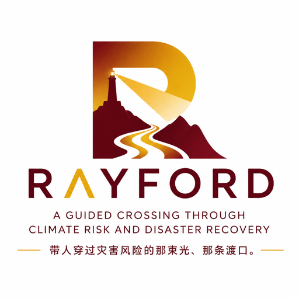

# Rayford AI

  

  <strong>Geospatial Physical AI for disaster evidence, resilience intelligence, and auditable property decisions.</strong>

Rayford AI builds **Ray**, a geospatial AI system that connects remote sensing,
street-level imagery, hazard context, and multimodal reasoning into
property-level evidence for disaster assessment, claims triage, and resilience
planning.

The organization is now structured as a research-to-product workspace: public
repositories show the scientific foundation, private advisor-access
repositories hold active disaster datasets and experiments, and product
workspaces translate the research into Ray workflows.

## Organization Snapshot

Current organization view, as of July 11, 2026:

| Area | Status |
| --- | --- |
| Public surface | Organization profile, website, and selected research repositories. |
| Advisor-access research | Private imports for datasets, cross-view reliability, preparedness, and disaster-agent pipelines. |
| Product and operations | Private Rayford AI company, product, and operating workspaces. |
| Main technical theme | Auditable disaster intelligence from street-view, satellite, aerial, and geospatial evidence. |

Public links work for anyone. Repositories marked **access required** are
private in the Rayford AI organization and require collaborator access.

## Ray Platform

Ray starts with disaster because disaster response exposes the hardest version
of the property-intelligence problem: evidence is incomplete, imagery arrives
at different times, models disagree, and human reviewers still need defensible
decisions.

| Module | What it does |
| --- | --- |
| **Ray Watch** | Monitor public hazard sources before and during events; preserve sourced event snapshots and declared unknowns. |
| **Ray Assess** | Turn pre-event and post-event imagery into property-level damage evidence, confidence, and review actions. |
| **Ray Claims** | Rank properties for adjuster review and package imagery, metadata, explanations, and uncertainty. |
| **Ray Risk** | Connect hazard history, built-environment context, and mitigation priorities for resilience planning. |
| **Ray Recover** | Track recovery status, evidence gaps, assistance needs, and community-scale resilience indicators. |

## Repository Map

### Public Repositories

| Repository | Role |
| --- | --- |
| [.github](https://github.com/Rayford-AI/.github) | Organization profile and shared public identity. |
| [Rayford-AI.github.io](https://github.com/Rayford-AI/Rayford-AI.github.io) | Public website for Rayford AI. |
| [Bi-Temporal-StreetView](https://github.com/Rayford-AI/Bi-Temporal-StreetView) | Hyperlocal hurricane damage assessment from paired pre/post street-view imagery. |
| [DamageArbiter](https://github.com/Rayford-AI/DamageArbiter) | CLIP-enhanced multimodal arbitration for street-view disaster damage assessment. |
| [Sat2Street-DisasterGen](https://github.com/Rayford-AI/Sat2Street-DisasterGen) | Generative satellite-to-street framework for post-disaster street-view synthesis. |
| [RAPID](https://github.com/Rayford-AI/RAPID) | Reproducible multi-agent pipeline for interpretable disaster damage assessment from satellite and street-view imagery. |
| [GenAI4Dresilience](https://github.com/Rayford-AI/GenAI4Dresilience) | Publication-safe companion for generative AI across the disaster-resilience lifecycle. |

### Advisor-Access Repositories

| Repository | Role |
| --- | --- |
| [disaster-crossview-datasets](https://github.com/Rayford-AI/disaster-crossview-datasets) | Curated index for wildfire, hurricane, and paired cross-view disaster datasets; **access required**. |
| [CrossViewGate](https://github.com/Rayford-AI/CrossViewGate) | Visibility-conditioned reliability gating for street-view and overhead damage assessment; **access required**. |
| [PrepStreet](https://github.com/Rayford-AI/PrepStreet) | Preparedness-oriented street-view analysis linked with hurricane forecasts, spatial context, and hazard features; **access required**. |
| [DisasterPilot](https://github.com/Rayford-AI/DisasterPilot) | Multi-agent event pipeline from public disaster watch to dossier, exposure, evidence, and decision products; **access required**. |
| [rayford-ai](https://github.com/Rayford-AI/rayford-ai) | Company workspace, brand, website material, and product-roadmap notes; **access required**. |
| hermes-work-manual | Internal operating manual for company workflows; **access required**. |

## Disaster Research Stack

The imported disaster projects now form a coherent stack rather than isolated
repositories:

| Layer | Repositories | Research question |
| --- | --- | --- |
| Data foundation | disaster-crossview-datasets, Bi-Temporal-StreetView | What imagery, metadata, labels, and provenance are available across wildfire, hurricane, and multi-hazard settings? |
| Street-level damage perception | Bi-Temporal-StreetView, DamageArbiter | How much does pre-event context improve property-level damage assessment, and how can visual-language signals make results interpretable? |
| Cross-view reliability | CrossViewGate, RAPID | When street-view and overhead evidence disagree, which view should be trusted and when should the system defer? |
| Generative evidence support | Sat2Street-DisasterGen, GenAI4Dresilience | Can generative models support scenario reasoning or missing-view analysis without being mistaken for observed evidence? |
| Preparedness modeling | PrepStreet | Can pre-disaster street-view, hazard forecasts, and spatial context anticipate likely post-event damage patterns? |
| Operational agents | DisasterPilot, RAPID | How can public event monitoring, exposure modeling, evidence assembly, and decision support become an auditable pipeline? |

## Advisor Reading Path

For a fast review:

1. Start with **disaster-crossview-datasets** to understand the data inventory,
   storage policy, and disaster coverage.
2. Read **Bi-Temporal-StreetView** and **DamageArbiter** for the street-view
   damage-assessment foundation.
3. Read **CrossViewGate** for the current reliability problem: conflict-aware
   cross-view damage assessment.
4. Read **PrepStreet** for the preparedness and pre-event modeling direction.
5. Read **DisasterPilot** for the end-to-end event workflow from public watch
   to decision products.
6. Use **RAPID**, **Sat2Street-DisasterGen**, and **GenAI4Dresilience** as the
   broader GenAI and multi-agent research context.

## Technical Principles

Rayford AI's disaster work is guided by a few non-negotiables:

- **Auditable outputs:** Every score should point back to imagery, metadata,
  source files, assumptions, and confidence.
- **View-aware reasoning:** Street-view, satellite, aerial, drone, and field
  imagery are not interchangeable; each view has its own failure modes.
- **Fail-closed behavior:** Missing imagery or missing metadata should produce
  a recorded evidence gap, not a fabricated answer.
- **Human review:** Ray should prioritize and explain evidence, not replace
  final claims, emergency-management, or recovery decisions.
- **Data discipline:** Raw imagery, protected datasets, and large generated
  artifacts stay private or local unless their license and review status allow
  public release.

## Research Foundation

Selected public research lines behind Ray include:

- **Computers, Environment and Urban Systems 2025:** Hyperlocal disaster damage
  assessment using bi-temporal street-view imagery.
- **2026 preprint:** DamageArbiter, a CLIP-enhanced multimodal arbitration
  framework for hurricane damage assessment.
- **IGARSS 2026:** Satellite-to-Street, synthesizing post-disaster street views
  from satellite imagery via generative vision models.
- **RAPID:** A reproducible multi-agent pipeline for interpretable disaster
  damage assessment from satellite and street-view imagery.
- **GenAI4Dresilience:** Generative AI for mitigation, preparedness, response,
  and recovery.

Public research context is also available at
[AutoGeoAI4Sci](https://autogeoai4sci.github.io/).

## Team

| Member | Role |
| --- | --- |
| **Yifan Yang** | Founder and Technical Lead; multimodal spatial intelligence, street-view analysis, model arbitration, and autonomous GeoAI systems. |
| **Dr. Lei Zou** | Scientific and Technical Advisor; GeoAI, spatial intelligence, and disaster resilience direction at Texas A&M University. |
| **Dr. Zhengzhong Tu** | Technical Advisor; computer vision, multimodal model design, and validation strategy. |
| **Dr. Heng Cai** | Technical Advisor; built environment context, infrastructure intelligence, and product-risk review. |

## Repository Policy

Rayford AI separates public visibility from private product and research
development.

- Public repositories may include company profiles, website assets,
  publication-safe research code, selected demos, and collaboration-facing
  summaries.
- Private repositories hold active experiments, dataset indexes, product code,
  customer discovery, pilot materials, and operating workflows.
- Public repository licenses apply only to the repository-authored materials
  they cover. Underlying third-party imagery, datasets, model outputs, and
  protected records remain subject to their own terms.

Rayford AI is not an open-source project by default. Public materials are shared
for visibility, evaluation, advisor review, and research collaboration;
proprietary product work remains protected unless explicitly released.

## Links

- Website: [rayford-ai.com](https://rayford-ai.com)
- GitHub: [Rayford-AI](https://github.com/Rayford-AI)
- LinkedIn: [Rayford AI](https://www.linkedin.com/company/rayford-ai)
- Contact: [contact@rayford-ai.com](mailto:contact@rayford-ai.com)

---

**Every property, ready and recoverable.**
