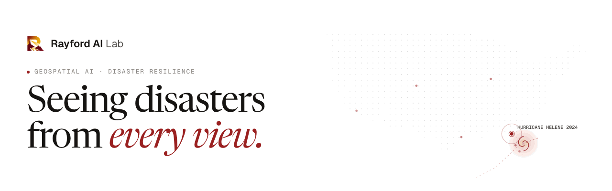

  Geospatial AI that reads satellite, street-view and drone imagery, explains what it sees, and shows the evidence behind every number. 
  从每一个视角看见灾害：读懂卫星、街景与无人机影像，并给出每个数字背后的证据。

  
  
  
  
  

## Featured

<table>
<tr>
<td width="33%" valign="top">
 
<b><a href="https://github.com/Rayford-AI/ray-resilience">RAY · Ray Resilience</a></b> 
ACM SIGSPATIAL 2026 · OASIS 
An accountable GeoAI agent for place-based disaster intelligence.
</td>
<td width="33%" valign="top">
 
<b><a href="https://github.com/Rayford-AI/CrossViewGate">CrossViewGate</a></b> 
GeoSearch ’26 · ACM SIGSPATIAL 
Trust the view that actually sees the damage.
</td>
<td width="33%" valign="top">
 
<b><a href="https://github.com/Rayford-AI/drone-compression-hpc">Drone Compression on HPC</a></b> 
SC26 · Poster 
Full-resolution drone imagery on GPU supercomputers.
</td>
</tr>
<tr>
<td width="33%" valign="top">
 
<b><a href="https://rayford295.github.io/PrepStreet/">PrepStreet</a></b> 
Extended abstract · 2026 
Seeing hurricane damage before it happens.
</td>
<td width="33%" valign="top">
 
<b><a href="https://github.com/Rayford-AI/vgi-spatial-bias">VGI Spatial Bias</a></b> 
I-GUIDE 2026 
Finding the gaps in OpenStreetMap across 102 counties.
</td>
<td width="33%" valign="top">
 
<b><a href="https://github.com/Rayford-AI/rayford-knowledge-atlas">Knowledge Atlas</a></b> 
Interactive graph 
From what we read to what it became.
</td>
</tr>
</table>

## Projects

| Theme | Project | Venue | Links |
| --- | --- | --- | --- |
| Damage assessment | [CrossViewGate](https://github.com/Rayford-AI/CrossViewGate) | GeoSearch ’26 | [Demo](https://rayford295.github.io/CrossViewGate/) · [Paper](https://dl.acm.org/doi/10.1145/3849732.3857333) |
| | [DamageArbiter](https://github.com/Rayford-AI/DamageArbiter) | arXiv 2026 | [Paper](https://arxiv.org/abs/2603.14837) |
| | [Bi-Temporal-StreetView](https://github.com/Rayford-AI/Bi-Temporal-StreetView) | CEUS 2025 | [Paper](https://doi.org/10.1016/j.compenvurbsys.2025.102335) |
| | [DisasterVLP](https://github.com/Rayford-AI/DisasterVLP) | ICC 2025 · Best Student Paper | [Paper](https://doi.org/10.5194/ica-abs-10-310-2025) |
| | [debris-estimate](https://github.com/Rayford-AI/debris-estimate) | In progress | |
| Generative AI | [Sat2Street-DisasterGen](https://github.com/Rayford-AI/Sat2Street-DisasterGen) | IGARSS 2026 | [Paper](https://arxiv.org/abs/2603.20697) |
| | [GenAI4Dresilience](https://github.com/Rayford-AI/GenAI4Dresilience) | CRC Press chapter | [Demo](https://rayford295.github.io/GenAI4Dresilience/) |
| | PrepStreet | Extended abstract 2026 | [Demo](https://rayford295.github.io/PrepStreet/) |
| Agents & LMMs | [ray-resilience](https://github.com/Rayford-AI/ray-resilience) | ACM SIGSPATIAL 2026 | [Demo](https://rayford295.github.io/ray-resilience/) |
| | [RAPID](https://github.com/Rayford-AI/RAPID) | arXiv 2026 | [Paper](https://arxiv.org/abs/2606.21819) |
| | [GeoLocator](https://github.com/Rayford-AI/GeoLocator) | Applied Sciences 2024 | [Paper](https://www.mdpi.com/2076-3417/14/16/7091) |
| Mapping & HPC | [drone-compression-hpc](https://github.com/Rayford-AI/drone-compression-hpc) | SC26 Poster | [Demo](https://rayford295.github.io/drone-compression-hpc/) |
| | [vgi-spatial-bias](https://github.com/Rayford-AI/vgi-spatial-bias) | I-GUIDE 2026 | [Demo](https://rayford295.github.io/vgi-spatial-bias/) |
| | [ArcGIS-SAM-TreeSegmentation](https://github.com/Rayford-AI/ArcGIS-SAM-TreeSegmentation) | Esri Press | |
| | Geothermal Awareness (GATES) | DOE project | [Demo](https://rayford295.github.io/geothermal-awareness/) |
| Resources | [awesome-autonomous-geoai](https://github.com/Rayford-AI/awesome-autonomous-geoai) | Curated list | [Site](https://autogeoai4sci.github.io/) |
| | [awesome-3dgs-geoai](https://github.com/Rayford-AI/awesome-3dgs-geoai) | Curated list · EN/中文 | |
| | [rayford-knowledge-atlas](https://github.com/Rayford-AI/rayford-knowledge-atlas) | Interactive graph | [Demo](https://rayford295.github.io/rayford-knowledge-atlas/) |

## People

|  |  |  |  |
| :---: | :---: | :---: | :---: |
| **Yifan Yang** 杨一帆 Lab Lead · Ph.D. Candidate | **Dr. Lei Zou** 邹雷 Scientific Advisor | **Dr. Zhengzhong Tu** 涂正中 Technical Advisor | **Dr. Heng Cai** 蔡恒 Technical Advisor |

Most repositories here are forks of the originals under <a href="https://github.com/rayford295">rayford295</a> and are kept in sync. Each carries its own license.

<i>Every place, ready and recoverable.</i>

